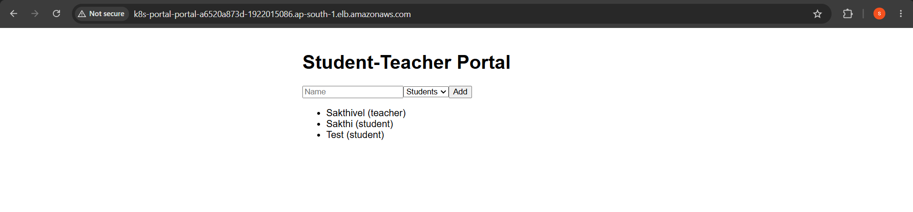
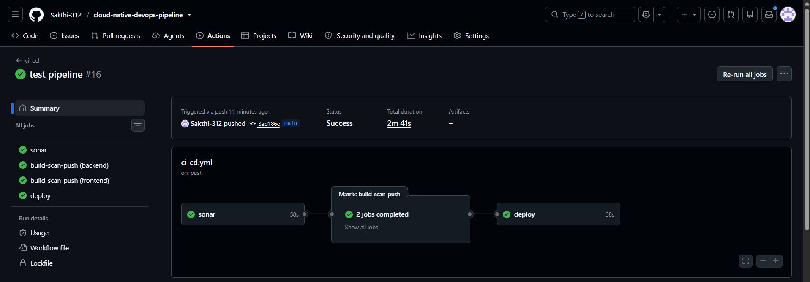
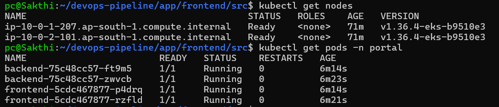
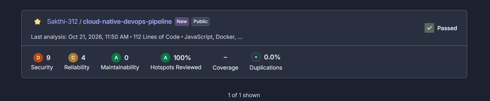
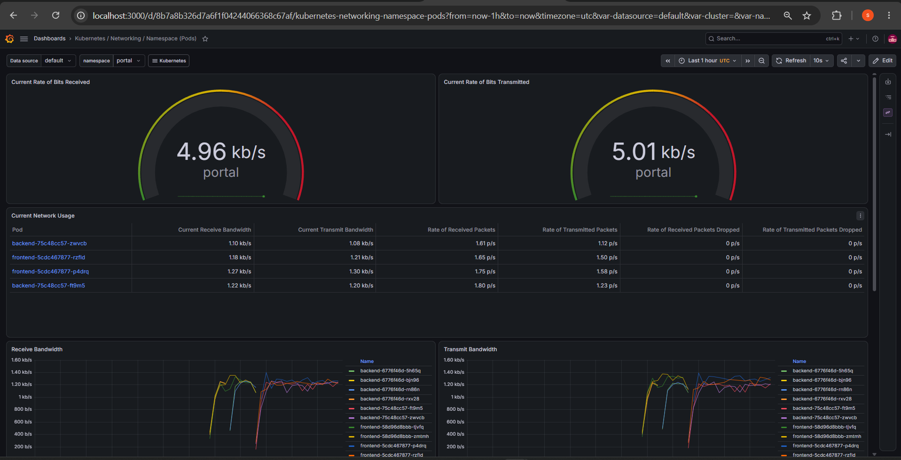
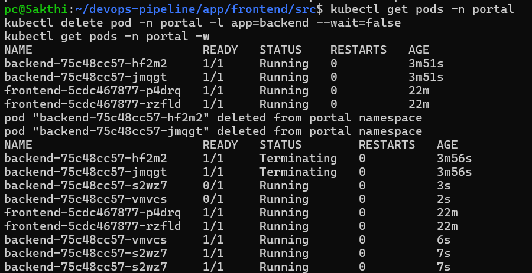

# Cloud-Native DevOps Delivery Pipeline

A 3-tier web application (React, Node.js, MySQL) deployed on **AWS EKS** with infrastructure provisioned by **Terraform** and a fully automated **CI/CD pipeline** on GitHub Actions. Every push runs code-quality analysis (SonarQube), builds Docker images, scans them for vulnerabilities (Trivy), pushes them to Amazon ECR, and rolls them out to Kubernetes. Prometheus and Grafana provide cluster monitoring.



---

## Table of contents

1. [What this project does](#what-this-project-does)
2. [Architecture](#architecture)
3. [Tech stack](#tech-stack)
4. [Repository structure](#repository-structure)
5. [CI/CD pipeline](#cicd-pipeline)
6. [Security design](#security-design)
7. [How to run it](#how-to-run-it)
8. [Monitoring](#monitoring)
9. [Challenges and what I learned](#challenges-and-what-i-learned)
10. [Cost and cleanup](#cost-and-cleanup)
11. [Future improvements](#future-improvements)
12. [Acknowledgements](#acknowledgements)

---

## What this project does

The application is a small Student-Teacher Portal: a user can add students and teachers and see them listed. The app itself is simple on purpose. The goal of the project is the **delivery platform around it**:

- Infrastructure is defined as code and can be created or destroyed with one command.
- Code changes reach production automatically, and only after passing quality and security checks.
- The app runs as multiple replicas on Kubernetes, so it recovers from pod failures on its own.
- The database is a managed Amazon RDS instance in a private subnet.

## Architecture

```
                        Internet
                           |
                  [ Application Load Balancer ]   (created by the AWS Load Balancer Controller)
                           |
        ---------------- AWS VPC (ap-south-1, 2 AZs) ----------------
        |                                                            |
        |   Public subnets:   ALB, NAT gateway                       |
        |                                                            |
        |   Private subnets:                                         |
        |     EKS cluster (2 x t3.medium nodes)                      |
        |       - frontend pods (Nginx + React build)  --/api-->     |
        |       - backend pods  (Node.js / Express)                  |
        |       - monitoring: Prometheus + Grafana                   |
        |                         |                                  |
        |                  [ Amazon RDS MySQL ]  (only reachable     |
        |                    from the EKS nodes)                     |
        --------------------------------------------------------------

   GitHub push --> GitHub Actions --> SonarQube --> Docker build --> Trivy --> ECR --> EKS
```


**Request flow:** the browser calls the ALB. The ALB sends traffic to the frontend pods (Nginx). Nginx serves the React app and forwards `/api/*` requests to the backend Service. The backend reads and writes to RDS MySQL.

## Tech stack

| Area | Tools |
|---|---|
| Cloud | AWS: VPC, EKS, EC2, RDS, ECR, ALB, IAM, S3 |
| Infrastructure as Code | Terraform (S3 remote state with locking) |
| Containers | Docker, multi-stage builds, Docker Compose for local development |
| Orchestration | Kubernetes (Deployments, Services, Ingress, Secrets, probes), Helm |
| CI/CD | GitHub Actions with OIDC authentication to AWS |
| Code quality | SonarQube Cloud (quality gate blocks the pipeline) |
| Security scanning | Trivy (image scan, fails on HIGH/CRITICAL fixable issues), ECR scan on push |
| Monitoring | Prometheus, Grafana (kube-prometheus-stack) |
| Application | React (Vite), Node.js 24 / Express, MySQL 8, Nginx |

## Repository structure

```
.
├── app/
│   ├── backend/             # Node.js API (/health, /api/people) + Dockerfile
│   └── frontend/            # React app, Nginx config + multi-stage Dockerfile
├── k8s/
│   ├── namespace.yaml
│   ├── backend.yaml         # Deployment + Service
│   ├── frontend.yaml        # Deployment + Service
│   ├── ingress.yaml         # ALB Ingress
│   └── monitoring-values.yaml
├── terraform/
│   ├── versions.tf          # providers and S3 backend
│   ├── variables.tf
│   ├── vpc.tf               # VPC, public/private subnets, NAT
│   ├── eks.tf               # EKS cluster and managed node group
│   ├── rds.tf               # RDS MySQL and security group
│   ├── ecr.tf               # ECR repositories (scan on push)
│   ├── lb-controller-iam.tf # IAM role for the AWS Load Balancer Controller
│   ├── github-oidc.tf       # IAM role GitHub Actions assumes via OIDC
│   └── outputs.tf
├── .github/workflows/ci-cd.yml
├── docker-compose.yml       # run the whole app locally
└── sonar-project.properties
```

## CI/CD pipeline



Triggered on every push to `main` that changes `app/`, `k8s/`, or the workflow:

```
sonar  -->  build-scan-push (backend, frontend in parallel)  -->  deploy
```

1. **SonarQube scan:** analyses the source and waits for the quality gate. If it fails, nothing else runs.
2. **Build:** each image is built and tagged with the Git commit SHA (no `latest`), so every running version is traceable to a commit.
3. **Trivy scan:** the image is scanned before it is pushed. HIGH and CRITICAL vulnerabilities with an available fix fail the build, so a vulnerable image never reaches ECR.
4. **Push:** the image is pushed to Amazon ECR.
5. **Deploy:** `kubectl set image` triggers a rolling update on EKS. The job waits on `rollout status` and fails if the rollout does not complete.

GitHub Actions authenticates to AWS with **OIDC**. There are no long-lived AWS access keys stored in GitHub.

## Security design

- **Private networking:** nodes and the database live in private subnets. Only the load balancer is public.
- **Least-privilege database access:** the RDS security group allows port 3306 only from the EKS node security group.
- **No static cloud credentials in CI:** GitHub Actions assumes an IAM role through OIDC, limited to this repository's `main` branch.
- **Scoped deploy permissions:** the CI role can push to the two ECR repositories, describe the cluster, and edit resources only inside the `portal` namespace.
- **Secrets stay out of Git:** database credentials are created as a Kubernetes Secret from the command line. `.env` and Terraform state are in `.gitignore`.
- **Shift-left scanning:** SonarQube on source code, Trivy on images, ECR scan on push.
- **Hardened images:** multi-stage frontend build, Alpine bases, OS packages patched, build tooling (npm) removed from the backend runtime image, and the backend runs as a non-root user.
- **Encrypted storage:** RDS storage encryption and an encrypted, versioned S3 bucket for Terraform state.

## How to run it

### Prerequisites

AWS account and CLI, Terraform, kubectl, Helm, Docker, Git. An S3 bucket for Terraform state (the name is set in `terraform/versions.tf`).

### 1. Run locally with Docker Compose

```bash
echo "DB_PASSWORD=ChangeMe123" > .env
docker compose up --build
# open http://localhost:8080
```

### 2. Create the infrastructure

```bash
cd terraform
export TF_VAR_db_password='<choose-a-password>'
terraform init
terraform apply
aws eks update-kubeconfig --region ap-south-1 --name $(terraform output -raw cluster_name)
kubectl get nodes
```

### 3. Push the first images to ECR

```bash
ACCOUNT=<aws-account-id>; REGION=ap-south-1; REGISTRY=$ACCOUNT.dkr.ecr.$REGION.amazonaws.com
aws ecr get-login-password --region $REGION | docker login --username AWS --password-stdin $REGISTRY

docker build -t $REGISTRY/terraform-portal-backend:v1 ./app/backend
docker push $REGISTRY/terraform-portal-backend:v1
docker build -t $REGISTRY/terraform-portal-frontend:v1 ./app/frontend
docker push $REGISTRY/terraform-portal-frontend:v1
```

### 4. Install the AWS Load Balancer Controller

```bash
cd terraform
helm repo add eks https://aws.github.io/eks-charts && helm repo update
helm install aws-load-balancer-controller eks/aws-load-balancer-controller -n kube-system \
  --set clusterName=$(terraform output -raw cluster_name) \
  --set region=ap-south-1 \
  --set vpcId=$(terraform output -raw vpc_id) \
  --set serviceAccount.create=true \
  --set serviceAccount.name=aws-load-balancer-controller \
  --set "serviceAccount.annotations.eks\.amazonaws\.com/role-arn=$(terraform output -raw lb_controller_role_arn)"
kubectl get pods -n kube-system | grep load-balancer   # wait for Running
```

### 5. Deploy the application

```bash
cd ..
kubectl apply -f k8s/namespace.yaml

kubectl create secret generic db-credentials -n portal \
  --from-literal=host=$(cd terraform && terraform output -raw rds_endpoint) \
  --from-literal=username=admin \
  --from-literal=password="$TF_VAR_db_password" \
  --from-literal=dbname=portal

kubectl apply -f k8s/backend.yaml -f k8s/frontend.yaml -f k8s/ingress.yaml
kubectl get ingress -n portal      # the ADDRESS column is the public URL
```



### 6. Enable the pipeline

In the GitHub repository, add:

- Repository **variable** `AWS_ROLE_ARN`: the `github_actions_role_arn` Terraform output.
- Repository **secret** `SONAR_TOKEN`: from your SonarQube Cloud project.

Push a change under `app/` and watch the **Actions** tab.



## Monitoring

```bash
helm repo add prometheus-community https://prometheus-community.github.io/helm-charts && helm repo update
kubectl create namespace monitoring
helm install monitoring prometheus-community/kube-prometheus-stack \
  -n monitoring -f k8s/monitoring-values.yaml

kubectl get secret -n monitoring monitoring-grafana -o jsonpath="{.data.admin-password}" | base64 -d; echo
kubectl port-forward -n monitoring svc/monitoring-grafana 3000:80
# open http://localhost:3000  (user: admin)
```



**Self-healing demo:** deleting the backend pods (`kubectl delete pod -n portal -l app=backend`) causes Kubernetes to recreate them within seconds, visible on the dashboard.



## Challenges and what I learned

- **GitHub OIDC trust failure.** The pipeline failed with `Not authorized to perform sts:AssumeRoleWithWebIdentity` even though the trust policy looked correct. I printed the real token claims inside the workflow and found GitHub now includes numeric account and repository IDs in the `sub` claim. Updating the trust policy to the new format fixed it. This taught me to debug authentication problems by inspecting what is actually sent rather than what I assume is sent.
- **Trivy blocked my first builds.** The scan failed on OpenSSL issues in the Alpine base image and on vulnerabilities in npm's own bundled packages. The application's dependencies were clean. I moved to a supported Node version, patched OS packages, and removed npm from the runtime image (it is only needed to install dependencies), after which the gate passed.
- **Destroy order matters.** The ALB is created by a Kubernetes controller, not by Terraform. Deleting the Ingress and letting the controller remove the load balancer before `terraform destroy` avoids a VPC that cannot be deleted.
- **Cost control.** An EKS-based environment costs money every hour it runs, so I built it to be created and destroyed repeatedly from code.

## Cost and cleanup

While running, this environment costs roughly **$0.30 to $0.40 per hour** (EKS control plane, two nodes, NAT gateway, RDS, ALB). Destroy it when you are done, in this order:

```bash
kubectl delete ingress portal -n portal
# wait until the load balancer is gone:
aws elbv2 describe-load-balancers --region ap-south-1 --query "LoadBalancers[].LoadBalancerName"

helm uninstall monitoring -n monitoring && kubectl delete namespace monitoring
helm uninstall aws-load-balancer-controller -n kube-system
kubectl delete namespace portal

cd terraform
export TF_VAR_db_password='any-value'
terraform destroy
```

## Future improvements

- Add a second region built with CloudFormation and Route 53 failover routing with health checks.
- Add unit tests and enable the SonarQube coverage condition.
- Use AWS Secrets Manager with the External Secrets Operator instead of creating the Kubernetes Secret by hand.
- Add HTTPS with ACM and a custom domain.
- Persist Prometheus data with the EBS CSI driver, and add alert rules.
- Move to a GitOps deployment model with Argo CD.

## Acknowledgements

The overall project idea (a multi-tier app on EKS with Terraform, an automated pipeline, and Prometheus/Grafana monitoring) was inspired by [ashutoshsanghi3/Cloud-Native-DevOps-Delivery-Pipeline](https://github.com/ashutoshsanghi3/Cloud-Native-DevOps-Delivery-Pipeline). The application code, Terraform, Kubernetes manifests, and workflow in this repository were written and debugged by me.

## Author

**Sakthivel M**: [GitHub](https://github.com/Sakthi-312) | [LinkedIn](https://www.linkedin.com/in/sakthi-vel-86b3a21b0)
